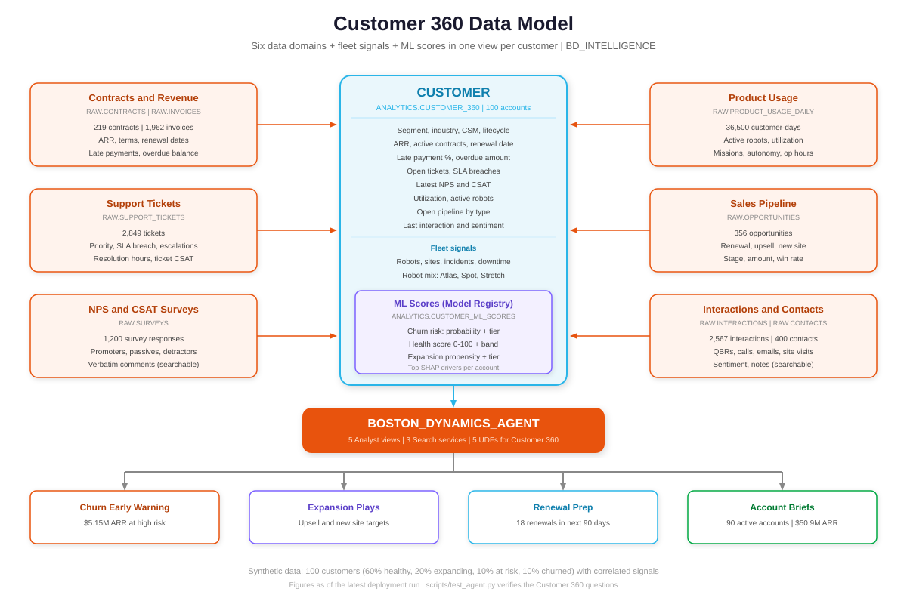
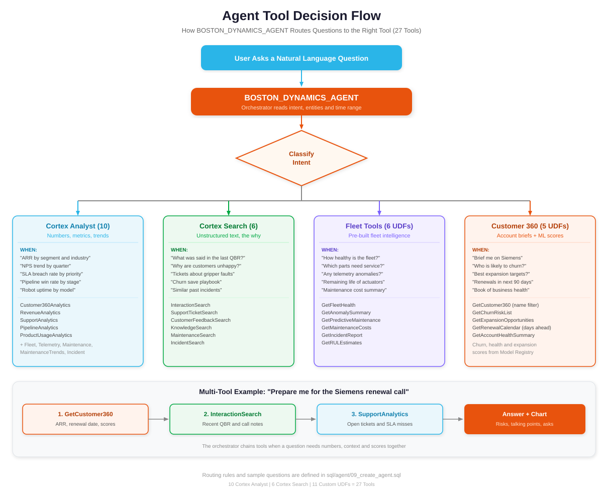

# Boston Dynamics — Snowflake Intelligence Agent

A complete Snowflake Intelligence architecture and implementation for Boston Dynamics. It answers natural language questions over robot fleet telemetry, maintenance, incidents and technical documentation, and adds a full **Customer 360**: contracts and revenue, support tickets, NPS/CSAT surveys, product usage, sales pipeline and customer interactions, with ML churn, health and expansion scores.

---

## Architecture


---

## Overview

Boston Dynamics is the global leader in mobile robots. This project builds a **Snowflake Intelligence Agent** for engineers, fleet operations, customer success managers, sales and executives, covering Atlas (humanoid), Spot (quadruped) and Stretch (warehouse) customers.

The agent (`BOSTON_DYNAMICS_AGENT`, 27 tools) combines:
- **Cortex Analyst**: Text-to-SQL over 10 semantic views (5 fleet, 5 Customer 360)
- **Cortex Search**: RAG over docs, maintenance and incident text, interaction notes, support tickets and survey verbatims (6 services)
- **Custom UDFs**: 11 agent functions (6 fleet, 5 Customer 360: account brief, churn risk list, expansion opportunities, renewal calendar, book-of-business health)
- **ML Models**: 5 models in the Snowflake Model Registry: predictive maintenance, remaining useful life, churn risk, customer health score, expansion propensity (plus Z-score anomaly detection)

---

## Customer 360



`BD_INTELLIGENCE.ANALYTICS.CUSTOMER_360` is one row per customer (78 columns) combining firmographics, ARR and renewals, payments, tickets and SLA, NPS trend, usage trend, pipeline, interaction sentiment, fleet incidents and the ML scores from `CUSTOMER_ML_SCORES`.

The synthetic data gives each of the 100 customers a hidden profile (60% healthy, 20% expanding, 10% at risk, 10% churned) that drives correlated signals across all domains, so the stories hang together: at-risk accounts show falling usage, detractor NPS, SLA misses, late payments and negative call notes.

---

## Quick Start

Deploy everything with the script (uses `~/.snowflake/connections.toml`):

```bash
python3 scripts/deploy.py --connection AWS161            # steps 1-6, 8, 9
python3 scripts/deploy.py --connection AWS161 --steps 3 4 # rerun selected steps
```

Or run the SQL files in order in Snowsight / SnowSQL:

```bash
sql/setup/01_database_and_schema.sql      # 1  Database, schemas, warehouse
sql/setup/02_create_tables.sql            # 2  17 tables
sql/data/03_generate_synthetic_data.sql   # 3  Synthetic data (run as one session; uses temp tables)
sql/views/04_create_views.sql             # 4  16 analytical views + CUSTOMER_ML_SCORES table
sql/views/05_create_semantic_views.sql    # 5  10 semantic views
sql/search/06_create_cortex_search.sql    # 6  6 Cortex Search services
notebooks/07_ml_models.ipynb              # 7  Train + register 5 models, write customer scores
sql/models/08_ml_model_functions.sql      # 8  11 agent UDFs
sql/agent/09_create_agent.sql             # 9  Create agent
```

Step 7 runs as a Snowflake Notebook, or locally with `python3 notebooks/07_ml_models.py` (needs `snowflake-ml-python`, `xgboost`, `scikit-learn`). Rerun step 6 after recreating tables, because search services must be rebuilt.

Verify the agent:

```bash
python3 scripts/test_agent.py --connection AWS161   # 10 Customer 360 questions
```

After deployment, open **AI & ML > Snowflake Intelligence** in Snowsight.

---

## Deployment Flow


---

## Project Structure

```
/
├── README.md
├── BUILD_LOG.md                           # Customer 360 build log with verification results
├── docs/
│   ├── AGENT_SETUP.md                     # Step-by-step setup guide
│   ├── DEPLOYMENT_SUMMARY.md              # Inventory of deployed objects
│   ├── questions.md                       # Test questions (fleet + Customer 360)
│   └── images/
│       ├── architecture.svg               # System architecture
│       ├── customer_360.svg               # Customer 360 data model
│       ├── agent_tool_decision.svg        # How the agent routes to tools
│       ├── deployment_flow.svg            # Deployment steps 01-09
│       └── ml_models.svg                  # ML pipeline and metrics
├── notebooks/
│   ├── 07_ml_models.ipynb                 # ML notebook (generated from the .py)
│   └── 07_ml_models.py                    # ML pipeline source
├── robot-rul-dashboard/                   # Streamlit RUL dashboard
├── scripts/
│   ├── deploy.py                          # Run deployment steps
│   ├── test_agent.py                      # Agent test questions
│   ├── build_notebook.py                  # Build .ipynb from .py
│   └── check_svg.py                       # Diagram text-fit checker
└── sql/
    ├── setup/   01_database_and_schema.sql, 02_create_tables.sql
    ├── data/    03_generate_synthetic_data.sql
    ├── views/   04_create_views.sql, 05_create_semantic_views.sql
    ├── search/  06_create_cortex_search.sql
    ├── models/  08_ml_model_functions.sql
    └── agent/   09_create_agent.sql
```

---

## Data Model

### Tables (BD_INTELLIGENCE.RAW): 17 tables, ~207K rows

| Table | Rows | Description |
|-------|------|-------------|
| CUSTOMERS | 100 | Accounts with segment, revenue, CSM, lifecycle stage |
| DEPLOYMENTS | 200 | Customer sites |
| ROBOTS | 600 | Atlas, Spot, Stretch fleet |
| COMPONENTS | 3,000 | Component lifecycle, status, inspection RUL |
| ROBOT_TELEMETRY | 150,000 | Sensor readings (12 months) |
| MAINTENANCE_RECORDS | 6,000 | Service history with costs |
| INCIDENTS | 1,382 | Incidents, severity, downtime, resolution |
| KNOWLEDGE_BASE | 25 | Technical articles + Customer Success playbooks |
| FIRMWARE_RELEASES | 30 | Firmware history |
| CONTACTS | 400 | Customer stakeholders |
| CONTRACTS | 219 | RaaS subscription, purchase + support, lease and expansion contracts |
| INVOICES | 1,962 | Billing and payment history |
| SUPPORT_TICKETS | 2,849 | Tickets with priority, SLA, CSAT |
| SURVEYS | 1,200 | NPS and CSAT responses with verbatims |
| PRODUCT_USAGE_DAILY | 36,500 | Daily usage per customer |
| OPPORTUNITIES | 356 | Renewal, upsell and new-site pipeline |
| INTERACTIONS | 2,567 | QBRs, calls, emails, site visits with notes |

### Semantic Views (BD_INTELLIGENCE.ANALYTICS)

| View | Covers |
|------|--------|
| BD_FLEET_OPERATIONS_SV | Robots, deployments, customers, component health |
| BD_TELEMETRY_ANALYTICS_SV | Battery, temperature, vibration, speed, errors |
| BD_MAINTENANCE_INTELLIGENCE_SV | Maintenance costs, frequency, scheduling |
| BD_MAINTENANCE_TRENDS_SV | Monthly maintenance trends by site and customer |
| BD_INCIDENT_ANALYSIS_SV | Incidents, severity, downtime, resolution |
| BD_CUSTOMER_360_SV | Account health, ARR, renewals, ML scores |
| BD_REVENUE_SV | Monthly billing, collections, late payments |
| BD_SUPPORT_SV | Tickets, SLA, resolution time, CSAT |
| BD_PIPELINE_SV | Opportunities, stages, win rates |
| BD_PRODUCT_USAGE_SV | Monthly adoption: utilization, missions, autonomy |

---

## ML Pipeline


| Model (BD_INTELLIGENCE.ML) | Algorithm | Purpose | Metric |
|-------|-----------|---------|--------|
| BD_PREDICTIVE_MAINTENANCE | Random Forest | Components needing attention | Test AUC 0.969 |
| BD_REMAINING_USEFUL_LIFE | Gradient Boosting | Days of remaining life | R² 0.952, MAE 198 days |
| BD_CHURN_RISK | XGBoost | Churn in next 180 days | Grouped-CV AUC 1.000 |
| BD_CUSTOMER_HEALTH_SCORE | XGBoost | Health score 0-100 | R² 0.963, MAE 2.1 |
| BD_EXPANSION_PROPENSITY | XGBoost | Expansion win in next 180 days | Grouped-CV AUC 0.816 |

Customer models train on `CUSTOMER_ML_FEATURES` (point-in-time monthly snapshots, 180-day forward labels, cross-validation grouped by customer so no account appears in both train and test). **These metrics are optimistic:** the synthetic data has deliberately clean signals. Expect lower scores on real data.

---

## Agent Tools (27)



| Tool | Type | Purpose |
|------|------|---------|
| FleetAnalytics | Cortex Analyst | Fleet status, deployments, customers |
| TelemetryAnalytics | Cortex Analyst | Sensor data, performance metrics |
| MaintenanceAnalytics | Cortex Analyst | Maintenance costs, scheduling |
| MaintenanceTrends | Cortex Analyst | Monthly maintenance trends |
| IncidentAnalytics | Cortex Analyst | Incidents, downtime, resolution |
| Customer360Analytics | Cortex Analyst | Account health, ARR, renewals, scores |
| RevenueAnalytics | Cortex Analyst | Billing, collections, payments |
| SupportAnalytics | Cortex Analyst | Tickets, SLA, CSAT |
| PipelineAnalytics | Cortex Analyst | Opportunities, win rates |
| ProductUsageAnalytics | Cortex Analyst | Utilization, missions, autonomy |
| KnowledgeSearch | Cortex Search | Technical docs, procedures, CS playbooks |
| MaintenanceSearch | Cortex Search | Maintenance notes |
| IncidentSearch | Cortex Search | Incident descriptions and root causes |
| InteractionSearch | Cortex Search | QBR, call, email and site visit notes |
| SupportTicketSearch | Cortex Search | Ticket subjects and descriptions |
| CustomerFeedbackSearch | Cortex Search | NPS / CSAT verbatims |
| GetFleetHealth | Custom UDF | Fleet health summary + score |
| GetAnomalySummary | Custom UDF | Anomalous sensor readings |
| GetPredictiveMaintenance | Custom UDF | Components needing service |
| GetMaintenanceCosts | Custom UDF | Spending breakdowns |
| GetIncidentReport | Custom UDF | Active incident summary |
| GetRULEstimates | Custom UDF | Remaining useful life |
| GetCustomer360 | Custom UDF | One-account brief (name filter) |
| GetChurnRiskList | Custom UDF | Accounts by churn risk with drivers |
| GetExpansionOpportunities | Custom UDF | Best expansion targets |
| GetRenewalCalendar | Custom UDF | Renewals in the next N days |
| GetAccountHealthSummary | Custom UDF | Book-of-business health and ARR at risk |

---

## Sample Questions

See [docs/questions.md](docs/questions.md). Examples:

- *"What is the current fleet health status?"*
- *"Which components need replacement within 30 days?"*
- *"Give me a 360 brief on Siemens before my renewal call."*
- *"Which customers are at highest risk of churn, and why?"*
- *"Which renewals are coming up in the next 90 days and how healthy are they?"*
- *"What are detractors saying in their NPS comments?"*

---

## Prerequisites

- Snowflake account with SYSADMIN (or ACCOUNTADMIN) role
- Cortex features enabled (Analyst, Search, Agents) and Snowflake Model Registry
- X-SMALL warehouse or larger (`BOSTON_DYNAMICS_WH` is created in step 1)

---

## Remote Streamlit Deployment

Run a Streamlit app in one region against live data in another, with no replication. The reference design hosts the app on Snowpark Container Services in a GCP `us-east4` account and queries a GCP `us-central1` account over a key-pair service-user connection.


| | |
|---|---|
| Use it when | The app needs always-current data and result sets are small (dashboards, aggregates, lookups) |
| Avoid it when | Queries pull large result sets, or every interaction needs low latency; use replication or a listing with auto-fulfillment instead |
| Cost | Compute in both accounts plus cross-region egress on result data |
| Security | `TYPE = SERVICE` user with key-pair auth, read-only role, private key held in a Snowflake secret, egress limited to the DATA account host |

Full guide (setup SQL for both accounts, app code, Dockerfile, service spec, deploy, update, security checklist and troubleshooting): [docs/STREAMLIT_CROSS_REGION_LIVE_CONNECTION.md](docs/STREAMLIT_CROSS_REGION_LIVE_CONNECTION.md). Section 11 maps it to this repo's Robot RUL dashboard.

---

## Documentation

- [Agent Setup Guide](docs/AGENT_SETUP.md): step-by-step deployment
- [Deployment Summary](docs/DEPLOYMENT_SUMMARY.md): inventory of deployed objects
- [Test Questions](docs/questions.md): fleet and Customer 360 questions
- [Remote Streamlit Deployment](docs/STREAMLIT_CROSS_REGION_LIVE_CONNECTION.md): cross-region Streamlit on SPCS with a live connection
- [Build Log](BUILD_LOG.md): Customer 360 build history and verification
