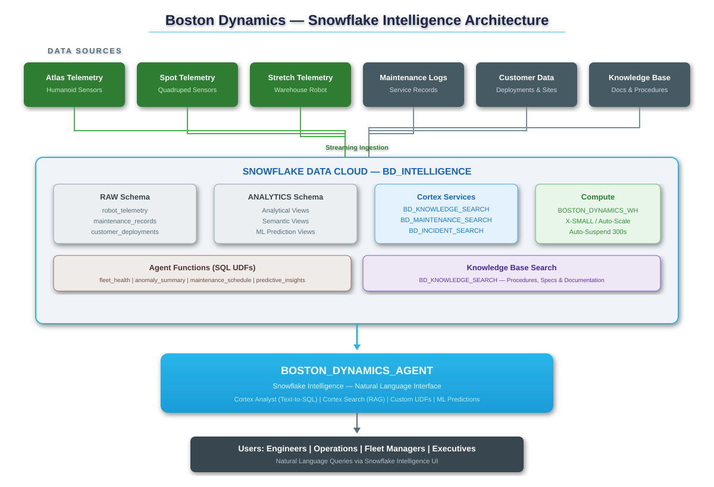
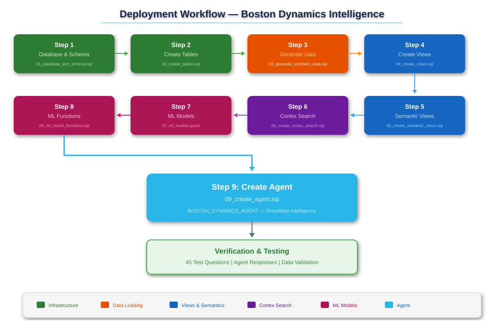

# Boston Dynamics Intelligence Agent — Setup Guide

This document provides step-by-step instructions for deploying the Boston Dynamics Intelligence Agent on Snowflake.

---

## Prerequisites

- Snowflake account with `SYSADMIN` (or equivalent) role access
- Warehouse creation privileges
- Cortex features enabled on your Snowflake account (Cortex Analyst, Cortex Search, Cortex Agents)
- SQL client (SnowSQL, Snowsight, or VS Code with Snowflake extension)

---

## Architecture Overview



The agent uses four tool categories:
- **Cortex Analyst (Text-to-SQL)** — 4 semantic views for structured data queries
- **Cortex Search (RAG)** — Knowledge base search over 80+ technical articles
- **Custom UDFs** — 6 agent functions for fleet health, anomalies, predictions, costs, incidents, and RUL
- **ML Models** — Predictive maintenance, anomaly detection, and remaining useful life estimation

---

## Deployment Flow



---

## Step-by-Step Deployment

### Step 1: Database & Schema Setup

```sql
-- Execute: sql/setup/01_database_and_schema.sql
-- Creates: BD_INTELLIGENCE database, RAW and ANALYTICS schemas, BOSTON_DYNAMICS_WH warehouse
```

Verify:
```sql
SHOW SCHEMAS IN DATABASE BD_INTELLIGENCE;
SHOW WAREHOUSES LIKE 'BOSTON_DYNAMICS_WH';
```

### Step 2: Create Tables

```sql
-- Execute: sql/setup/02_create_tables.sql
-- Creates: 9 tables (ROBOTS, ROBOT_TELEMETRY, COMPONENTS, MAINTENANCE_RECORDS,
--          CUSTOMERS, DEPLOYMENTS, INCIDENTS, KNOWLEDGE_BASE, FIRMWARE_RELEASES)
```

Verify:
```sql
SHOW TABLES IN SCHEMA BD_INTELLIGENCE.RAW;
```

### Step 3: Generate Synthetic Data

```sql
-- Execute: sql/data/03_generate_synthetic_data.sql
-- Generates: ~54,000 rows across all tables
```

Verify:
```sql
SELECT 'ROBOTS' AS TBL, COUNT(*) AS CNT FROM BD_INTELLIGENCE.RAW.ROBOTS
UNION ALL SELECT 'TELEMETRY', COUNT(*) FROM BD_INTELLIGENCE.RAW.ROBOT_TELEMETRY
UNION ALL SELECT 'COMPONENTS', COUNT(*) FROM BD_INTELLIGENCE.RAW.COMPONENTS
UNION ALL SELECT 'MAINTENANCE', COUNT(*) FROM BD_INTELLIGENCE.RAW.MAINTENANCE_RECORDS
UNION ALL SELECT 'CUSTOMERS', COUNT(*) FROM BD_INTELLIGENCE.RAW.CUSTOMERS
UNION ALL SELECT 'DEPLOYMENTS', COUNT(*) FROM BD_INTELLIGENCE.RAW.DEPLOYMENTS
UNION ALL SELECT 'INCIDENTS', COUNT(*) FROM BD_INTELLIGENCE.RAW.INCIDENTS
UNION ALL SELECT 'KNOWLEDGE_BASE', COUNT(*) FROM BD_INTELLIGENCE.RAW.KNOWLEDGE_BASE
UNION ALL SELECT 'FIRMWARE', COUNT(*) FROM BD_INTELLIGENCE.RAW.FIRMWARE_RELEASES;
```

Expected counts:
| Table | Rows |
|-------|------|
| ROBOTS | 200 |
| ROBOT_TELEMETRY | 50,000 |
| COMPONENTS | 1,000 |
| MAINTENANCE_RECORDS | 2,000 |
| CUSTOMERS | 30 |
| DEPLOYMENTS | 60 |
| INCIDENTS | 500 |
| KNOWLEDGE_BASE | 80 |
| FIRMWARE_RELEASES | 30 |

### Step 4: Create Analytical Views

```sql
-- Execute: sql/views/04_create_views.sql
-- Creates: 8 analytical views in the ANALYTICS schema
```

Verify:
```sql
SHOW VIEWS IN SCHEMA BD_INTELLIGENCE.ANALYTICS;
```

### Step 5: Create Semantic Views

```sql
-- Execute: sql/views/05_create_semantic_views.sql
-- Creates: 4 semantic views for Cortex Analyst
```

Verify:
```sql
SHOW SEMANTIC VIEWS IN SCHEMA BD_INTELLIGENCE.ANALYTICS;
```

### Step 6: Create Cortex Search Service

```sql
-- Execute: sql/search/06_create_cortex_search.sql
-- Creates: BD_KNOWLEDGE_SEARCH Cortex Search service
```

Verify:
```sql
SHOW CORTEX SEARCH SERVICES IN SCHEMA BD_INTELLIGENCE.ANALYTICS;
```

### Step 7: ML Model Training (Optional)

```
-- Execute: notebooks/07_ml_models.ipynb
-- Trains: Predictive Maintenance, Anomaly Detection, RUL models
-- Note: This step is optional. The agent UDFs use threshold-based logic
--        that works without the trained models.
```

### Step 8: Create Agent Functions

```sql
-- Execute: sql/models/08_ml_model_functions.sql
-- Creates: 6 SQL UDFs exposed to the agent as custom tools
```

Verify:
```sql
SELECT AGENT_GET_FLEET_HEALTH();
SELECT AGENT_GET_ANOMALY_SUMMARY();
```

### Step 9: Create the Agent

```sql
-- Execute: sql/agent/09_create_agent.sql
-- Creates: BOSTON_DYNAMICS_AGENT in SNOWFLAKE_INTELLIGENCE.AGENTS schema
```

Verify:
```sql
SHOW AGENTS IN SCHEMA SNOWFLAKE_INTELLIGENCE.AGENTS;
DESC AGENT SNOWFLAKE_INTELLIGENCE.AGENTS.BOSTON_DYNAMICS_AGENT;
```

---

## Testing the Agent

After deployment, navigate to **AI & ML > Snowflake Intelligence** in Snowsight to interact with the agent. Test with questions from `docs/questions.md`.

Sample test queries:
1. "What is the current fleet health status?"
2. "Which robots have anomalous sensor readings?"
3. "How do I calibrate the LiDAR on a Spot robot?"
4. "What is the total maintenance cost by robot model?"

---

## Troubleshooting

| Issue | Solution |
|-------|----------|
| Agent not visible in Snowflake Intelligence | Verify agent was created in `SNOWFLAKE_INTELLIGENCE.AGENTS` schema |
| Semantic view errors | Re-run Step 4 (views) before Step 5 (semantic views) |
| Cortex Search not returning results | Wait for initial indexing (up to 1 hour with `TARGET_LAG = '1 hour'`) |
| UDF errors | Verify tables have data (Step 3) and views exist (Step 4) |
| Permission denied | Grant USAGE on agent and all underlying resources to user roles |
