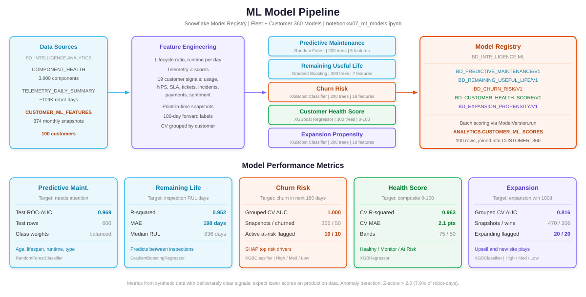

# Boston Dynamics Intelligence Agent — Deployment Summary

**Project:** Boston Dynamics Snowflake Intelligence Agent  
**Date:** March 2026  
**Status:** Ready for Deployment

---

## Architecture


---

## Deployment Flow


---

## ML Pipeline



---

## What Was Built

### Database: `BD_INTELLIGENCE`

| Schema | Purpose |
|--------|---------|
| `RAW` | Raw ingestion layer — 9 tables for robot telemetry, maintenance, customers, deployments, incidents, knowledge base, firmware |
| `ANALYTICS` | Analytical layer — 8 views, 4 semantic views, 1 Cortex Search service, 6 agent UDFs |

### Tables (RAW Schema)

| Table | Rows | Description |
|-------|------|-------------|
| ROBOTS | 200 | Robot fleet inventory (Atlas, Spot, Stretch) |
| ROBOT_TELEMETRY | 50,000 | Streaming sensor data (battery, temp, vibration, speed) |
| COMPONENTS | 1,000 | Component lifecycle tracking (motors, sensors, batteries) |
| MAINTENANCE_RECORDS | 2,000 | Service history with costs and durations |
| CUSTOMERS | 30 | Customer organizations across 6 industries |
| DEPLOYMENTS | 60 | Deployment sites worldwide |
| INCIDENTS | 500 | Incident tracking with severity and resolution |
| KNOWLEDGE_BASE | 80 | Technical documentation articles |
| FIRMWARE_RELEASES | 30 | Firmware version history |

### Analytical Views (ANALYTICS Schema)

| View | Purpose |
|------|---------|
| FLEET_OVERVIEW | Robot fleet with deployment and component health |
| TELEMETRY_DAILY_SUMMARY | Daily aggregated telemetry per robot |
| MAINTENANCE_ANALYSIS | Maintenance cost and frequency analytics |
| INCIDENT_DASHBOARD | Incident severity and downtime analysis |
| COMPONENT_HEALTH | Component lifecycle and risk assessment |
| CUSTOMER_FLEET_SUMMARY | Per-customer fleet overview |
| ROBOT_MODEL_PERFORMANCE | Cross-model performance comparison |
| DEPLOYMENT_PERFORMANCE | Per-site deployment metrics |

### Semantic Views (Cortex Analyst)

| Semantic View | Source View | Enables |
|---------------|-------------|---------|
| BD_FLEET_OPERATIONS_SV | FLEET_OVERVIEW | Fleet status, deployments, customers |
| BD_TELEMETRY_ANALYTICS_SV | TELEMETRY_DAILY_SUMMARY | Sensor data, performance metrics |
| BD_MAINTENANCE_INTELLIGENCE_SV | MAINTENANCE_ANALYSIS | Maintenance costs, scheduling |
| BD_INCIDENT_ANALYSIS_SV | INCIDENT_DASHBOARD | Incident tracking, downtime |

### Cortex Search Service

| Service | Source | Description |
|---------|--------|-------------|
| BD_KNOWLEDGE_SEARCH | KNOWLEDGE_BASE | RAG search over 80 technical articles covering Atlas, Spot, and Stretch documentation |

### Agent Functions (SQL UDFs)

| Function | Returns | Purpose |
|----------|---------|---------|
| AGENT_GET_FLEET_HEALTH() | OBJECT | Overall fleet health summary with health score |
| AGENT_GET_ANOMALY_SUMMARY() | ARRAY | Anomalous telemetry readings (past 7 days) |
| AGENT_GET_PREDICTIVE_MAINTENANCE() | ARRAY | Components predicted to need service |
| AGENT_GET_MAINTENANCE_COST_SUMMARY() | OBJECT | Maintenance spending breakdown |
| AGENT_GET_INCIDENT_REPORT() | OBJECT | Active incident summary |
| AGENT_GET_RUL_ESTIMATES() | ARRAY | Remaining useful life estimates |

### ML Models (Notebook)

| Model | Type | Target |
|-------|------|--------|
| Predictive Maintenance | Random Forest Classifier | Component failure prediction |
| Anomaly Detection | Z-Score Statistical | Abnormal telemetry patterns |
| Remaining Useful Life | Gradient Boosting Regressor | Days until replacement |

---

## Agent Configuration

- **Name:** `SNOWFLAKE_INTELLIGENCE.AGENTS.BOSTON_DYNAMICS_AGENT`
- **Tools:** 11 total (4 Cortex Analyst + 1 Cortex Search + 6 Custom UDFs)
- **Warehouse:** `BOSTON_DYNAMICS_WH` (X-SMALL, auto-suspend 300s)
- **Access:** Granted to PUBLIC role

---

## Files Created

```
/
├── README.md
├── docs/
│   ├── AGENT_SETUP.md
│   ├── DEPLOYMENT_SUMMARY.md
│   ├── questions.md
│   └── images/
│       ├── architecture.svg
│       ├── deployment_flow.svg
│       └── ml_models.svg
├── notebooks/
│   └── 07_ml_models.ipynb
└── sql/
    ├── setup/
    │   ├── 01_database_and_schema.sql
    │   └── 02_create_tables.sql
    ├── data/
    │   └── 03_generate_synthetic_data.sql
    ├── views/
    │   ├── 04_create_views.sql
    │   └── 05_create_semantic_views.sql
    ├── search/
    │   └── 06_create_cortex_search.sql
    ├── models/
    │   └── 08_ml_model_functions.sql
    └── agent/
        └── 09_create_agent.sql
```

---

## Execution Order

| Step | File | Duration |
|------|------|----------|
| 1 | `sql/setup/01_database_and_schema.sql` | ~5 seconds |
| 2 | `sql/setup/02_create_tables.sql` | ~5 seconds |
| 3 | `sql/data/03_generate_synthetic_data.sql` | ~30 seconds |
| 4 | `sql/views/04_create_views.sql` | ~5 seconds |
| 5 | `sql/views/05_create_semantic_views.sql` | ~5 seconds |
| 6 | `sql/search/06_create_cortex_search.sql` | ~30 seconds + indexing |
| 7 | `notebooks/07_ml_models.ipynb` | ~2 minutes (optional) |
| 8 | `sql/models/08_ml_model_functions.sql` | ~5 seconds |
| 9 | `sql/agent/09_create_agent.sql` | ~10 seconds |
